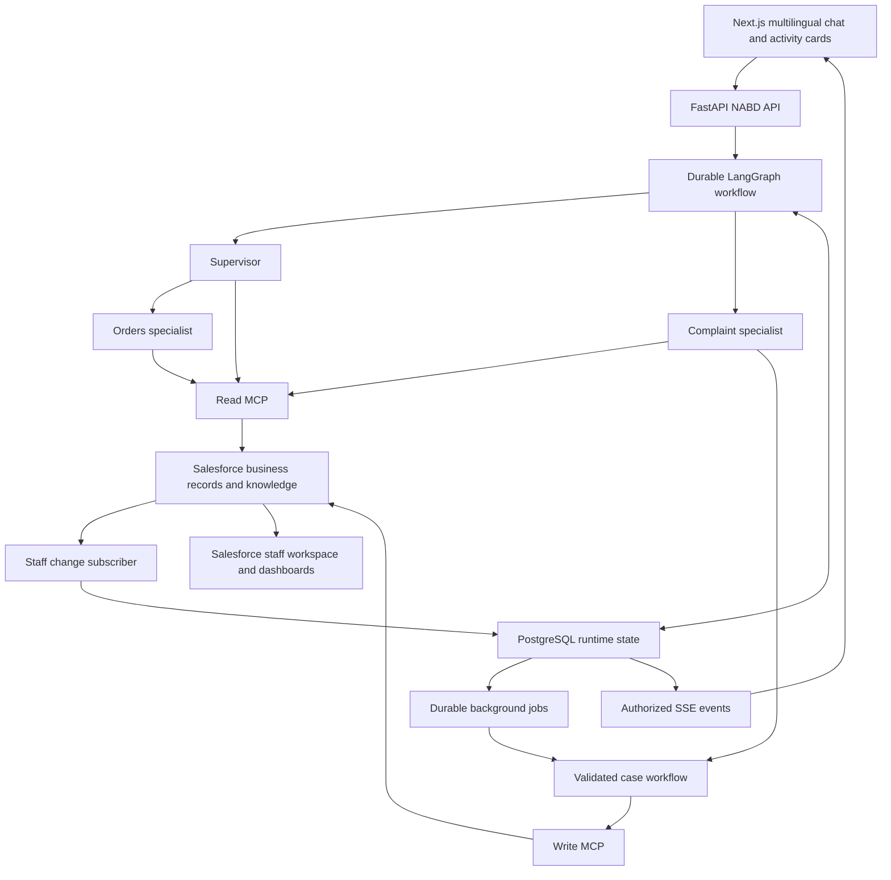

# NABD architecture

This is the target architecture. [Status](status.md) distinguishes implemented
foundation from planned features. [Decisions](decisions.md) is the accepted
product contract; [contracts](contracts.md) describes future interfaces.

## Current boundary: Phases 0–1

Phase 1 adds `backend/code/nabd/salesforce/`: the schema contract that
generates `salesforce/` metadata, fixture seed/verify commands, client
credentials authentication and the typed customer-scoped read adapter. No
FastAPI route uses Salesforce yet. Concrete objects, fields and access are in
[NABD Salesforce](salesforce.md). The Phase 0 boundary below is unchanged.

### Phase 0 foundation

`backend/code/nabd/app.py` is a standalone FastAPI application with health and
readiness endpoints. Its lifespan owns a psycopg asynchronous pool and an
`AsyncPostgresSaver`; it imports no voice runtime and constructs no LLM.
`nabd/settings.py` is the single configuration boundary for the text runtime.

Alembic upgrades application schemas; the official checkpointer upgrades its
own tables. The explicit migration command runs both under one advisory lock.
Startup never performs DDL. Readiness verifies connectivity and both schema
versions; liveness stays independent of storage health.

The `nabd` PostgreSQL namespace currently holds checkpoint tables. Application
tables arrive with their consumers. Checkpoint deserialization restricts custom
module reconstruction; primitive state and built-in LangChain messages are
covered by the process-restart test.

`agents/graph.py`, `agents/models.py`, and `core/trace.py` remain reuse candidates.
The existing Supervisor and Orders graphs are tested legacy behavior; their
direct SQLite tools, identity gate, voice prompts, and thread/idle callbacks
must be adapted in phases 2–3 before becoming the NABD runtime. The existing
frontend remains a voice prototype until Phase 2.

## Agents and turn control

| Role | Purpose | Output/access |
| --- | --- | --- |
| Supervisor | Customer dialogue, language adaptation, clarification, delegation | Knowledge reads, specialist requests, grounded response |
| Orders | Order/delivery/return-eligibility investigation | Customer-scoped reads; typed findings with evidence |
| Complaints | Distinct issues, case matching, category/sentiment/impact assessment | Case/history reads and typed action proposals |
| Quality evaluator | Post-interaction groundedness, coverage, language and tool-use review | Read-only grades and review signals |

Agent count is independent of deployment count: keep graph components in one
backend codebase. Summarization reuses Complaint capabilities. Routing, case
lifecycle, and risk calculations are explicit workflows.

Turn sequence:

1. Bind trusted customer identity; persist an idempotent incoming message.
2. Supervisor investigates using real tools and conditional Orders delegation.
3. Required Complaint analysis consumes the message, relevant history, and tool
   evidence. Return no complaint, clarification needs, or one/more issues.
4. Validate proposals and refresh current Salesforce state; execute accepted
   commands through write MCP and record confirmed/pending/failed outcomes.
5. Supervisor streams a reply grounded in available evidence and command receipts.
6. Enqueue summary refinement, risk evaluation, and later quality evaluation.

Await dependent specialist results in the graph. Put actual post-response work
in durable jobs. Serialize turns per conversation and conflicting customer case
mutations. Extra messages queue visibly. Initial budgets: five tool calls per
agent invocation, twenty shared per turn, and a 120-second active-turn deadline.
Pending external operations are reconciled by the worker after that deadline.

## Data and integration ownership

| Store | Authoritative data |
| --- | --- |
| Salesforce | Customers, orders/items/deliveries, published FAQ/policy revisions, cases, original complaint evidence, tasks, warnings, command receipts |
| PostgreSQL | Conversations/messages, checkpoints, issue links, execution receipts, pending jobs, customer activity log and synchronization cursors |
| Repository fixtures | Repeatable synthetic deployment/test inputs; no live authority |

Use Account/Contact, standard Case/Task, custom ShopEasy commerce objects, and
versioned `KnowledgeEntry__c` records. The Salesforce model and exact fields are
Phase 1 deliverables. KnowledgeEntry avoids optional Knowledge licensing while
keeping staff editing and published revisions in Salesforce. Retain GBP and
one set of policies. Reviews cite the retrieved policy revision, not a model's
memory.

Salesforce authentication uses an External Client App and client credentials
with restricted integration permissions. Read and write MCP surfaces expose
only named business operations. Signed trusted context binds the customer and
allowed scope; the model does not provide it. Salesforce query construction
stays in the adapter with whitelisted fields/validated parameters. Apply
authorization to resources and prompts as well as tools.

The write adapter uses a typed Apex command gateway: validate expected record
version and permitted transition, lock affected records, apply the mutation,
and save a unique operation receipt in one Salesforce transaction. Persist the
command locally before dispatch. An ambiguous timeout requires reconciliation
before retry. Respect staff overrides and surface conflicts.

Retry idempotency is separate from semantic complaint matching. The latter
retrieves authorized candidate cases and uses evidence-backed AI judgment,
asking for clarification when necessary. Never assume an external ID proves
that two different descriptions refer to the same issue.

## Activity streaming and staff synchronization

Use HTTP message submission and SSE for response chunks and live activities.
Persist important events/chunks with per-conversation sequence IDs. Support
Last-Event-ID replay and a current-state snapshot after gaps. Nested activities
link tool work to specialists. A case queue/number appears only after confirmed
Salesforce results. Templates localize progress without extra model calls.

Public activity is a deliberate server-side projection of execution events.
The restricted developer view correlates graph transitions/tool traces and
timings; the customer receives only useful authorized actions/evidence.

For staff changes, publish after-commit platform events for Cases and public
CaseComments. A Pub/Sub worker stores replay cursors after durable processing,
retrieves current authorized state, then appends customer events. Deduplicate
write acknowledgments and echoed Salesforce events. Reconcile after reconnect
and periodically; handle privacy changes/deletion. Staff synchronization has a
five-second healthy-connection p95 target; execution events have a one-second
server-to-browser p95 target. Dashboards show data freshness.

## Risk and quality

Starting risk rules are versioned, configurable defaults: three distinct
complaints in thirty days; High-priority case unresolved for twenty-four hours;
or sentiment becoming negative and remaining negative at the next follow-up for
the same unresolved issue. Evaluate after changes and hourly for aging.
One active customer/rule episode owns one task; update evidence without repeats.
Keep risk scores/internal assessments out of customer streams.

Initial priority defaults: High for reported safety/security incidents or
suspected unauthorized/duplicate charges; Medium for lost parcels or repeated
unresolved issues; Low for routine issues without stronger evidence. Preserve
reported-versus-verified facts and route uncertainty to staff review. Test rules
against scenarios before release; staff overrides remain authoritative.

Evaluate behavior by language/form, cases/side effects, data grounding, and tool
evidence. Use deterministic assertions for permissions/invariants and labeled
semantic scenarios with manual Darija review. The quality evaluator is read-only;
summary correction is bounded to one pass. Release targets are in the roadmap,
and must be measured rather than presented as current performance.
